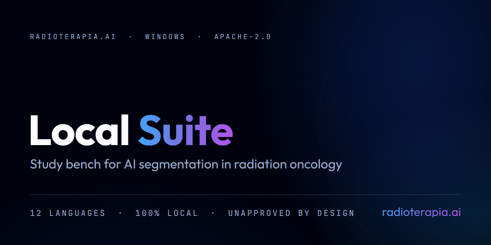
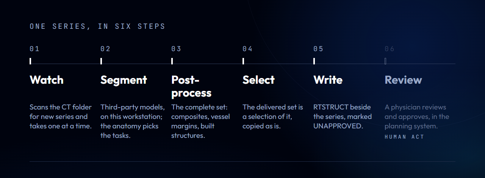
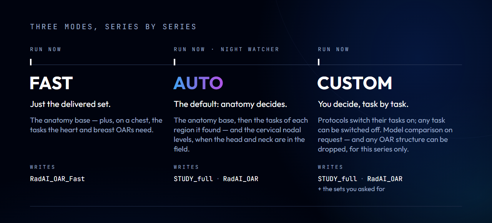

# Radioterapia.AI — Local Suite

**Part of the Radioterapia.AI local ecosystem. A study bench for AI segmentation in radiation oncology — teaching and research material, not a medical device.**

`License: Apache-2.0` · `Version: 8.12` · `Platform: Windows 10 and 11, 64-bit` · `Interface: twelve languages`

> **Teaching and research material. This is not a medical device.**
> It is **not** validated for clinical use, it has no ANVISA registration, no
> CE mark and no FDA clearance, and it must not be used as a production
> contouring tool. Every structure it writes is an **unapproved suggestion**;
> reviewing and approving it is a physician's act, in the planning system.
> Detection of findings ships in the package and never runs by default: it
> runs only by a declared act of whoever operates it, series by series. The
> model that recognises anatomy here — [TotalSegmentator][ts] — says the same
> thing about itself, in its own README: *"This is not a medical device and is
> not intended for clinical usage."* This project inherits that position and
> does not soften it. See [NOTICE](NOTICE).

The code is educational material. Whoever downloads, modifies and deploys it
answers for their own build, and for validating it in their own service.

## What it does

  

It is a post‑processing layer and a compiler of existing segmentation models:
it runs third‑party models over a CT (or an MR) on the department's own
Windows workstation, turns what they draw into radiotherapy structures, and
writes an RTSTRUCT beside the series, so that the planning system imports
them as suggestions to review. It can also run several models over the same
scan and put their results side by side. The models are not trained on the
department's cases.

Open segmentation models already draw more than a hundred structures on a
CT. Getting that into a radiotherapy plan is another job: a Python
environment with the right libraries and weights, a GPU — or the patience to
wait for a CPU —, an RTSTRUCT the planning system accepts, names it
recognises, and the constructions a plan actually uses. An organ at risk is
not the organ the model draws: it is a heart with its pericardium, a chest
wall, a bowel bag, a femur cut at the ischial tuberosity.

  

1. **Watch** — the watcher scans the CT folder for new series and takes one
   at a time. Several workstations can share the same folder: they coordinate
   by marker files beside each series, with no central server.
2. **Segment** — third‑party models run on this workstation. The anatomy the
   base model drew decides which extra tasks run; the text of the exam does
   not.
3. **Post‑process** — the complete set: composites, a margin on every vessel
   and on the trachea, the structures built from others, and four rules that
   drop what should not be recorded at all.
4. **Select** — the delivered set is an exact selection of the complete one,
   copied as is.
5. **Write** — an RTSTRUCT beside the series, marked `UNAPPROVED`, each set as
   its own series, finished for the ring drawing set in *Settings → General*
   («Eclipse / Monaco» by default, or «Xio / Focal» for systems that need a
   dividing line in rings), in Implicit VR Little Endian, with every contour
   in the plane of the series' own slices — axial, sagittal, coronal or
   oblique, as an MR may come; repeated vertices are
   removed, a zero‑area contour is redrawn from its pixel outline instead of
   being dropped, and a contour that smoothing or point reduction made cross
   itself goes back to its shape before them — the log counts each fix, and
   any contour that still crosses itself.
6. **Review** — a physician reviews and approves, in the planning system.
   That step is not the program's, and there is no path through the program
   that approves anything. Before any queue starts, the start dialog says so.

### Three modes, series by series

  

| mode | where | what runs | what it writes |
|---|---|---|---|
| **FAST** | *Run now* | the anatomy base; chest tasks for heart, breast and effusions; head-gland and CT-brain sources for eyes, lenses, optic nerves, brainstem and chiasm when the head is in the field | only `RadAI_STUDY_Fast`: no bowel bag, anus, skin, chest walls, ribs, sternum or costal-cartilage ROIs; necessary heart-cropping inputs remain internal; the same dense point writer as STUDY and FULL |
| **AUTO** | *Run now*, and always the night watcher | the base, then the tasks of each region it found (the head‑and‑neck tasks only when the neck is confirmed, vertebrae and mandible), the CT brain model when the brain is in the field, and the cervical nodal levels when the head and neck are in the field | `RadAI_FULL` + `RadAI_STUDY` |
| **CUSTOM** | *Run now* | protocols switch their tasks on, and any task can be switched off; or a *custom protocol* of the workstation chooses the delivered structures; model comparison on request; any structure can be dropped from the delivered set, for that series only | `RadAI_FULL` + `RadAI_STUDY` + the sets you asked for |

FAST is not a second post‑processing: it runs the same one, filtered to what
its file carries. Sternum remains an internal heart input when needed and remains in AUTO/custom STUDY and FULL. Aorta yields overlapping voxels to the final esophagus before the GreatArteries union; the final union also excludes the esophagus.

Settings includes **Check for updates** for an application already running. A machine-only update decision keeps its response available to the application; if that decision fails, the interface can open the installer it already downloaded and verified.

### Five base modules and an optional plugin

NEURO RT is installed separately from its [public release](https://github.com/drhenriquebraga/neuro-rt/releases/latest), through the home card or Settings. Nidus, Glioma, Metastasis, Meningioma and Anatomy are available in a testing phase. Installation and first use have their own terms; entering a tool also requires explicit participation in its testing phase. Models run only when requested and RTSTRUCT results remain unapproved suggestions. The plugin reuses the installed suite Python and compatible libraries, with additional resources kept under the plugin. Base updates preserve installed plugins.

Settings provides an explicit update check and a local folder option for a compatible SETUP or offline package. Maintenance opens a visible PowerShell window, closes the suite after the installer confirms readiness, and opens a new suite window after preparation. NEURO RT START HERE opens this maintenance screen or builds an offline package on a connected computer for transport. GitHub releases contain only the lightweight versioned SETUP and its LATEST alias; offline bundles are built locally.

| | |
|---|---|
| **DicomBridge** | one card, one pipeline that opens step by step — load (files, a folder read in the background with the series appearing as they are found, **Load a CD**, which reads the whole disc, folders and subfolders, without writing to it, or **Import image**, a JPEG, PNG, TIFF or BMP picked in the Windows file dialog), choose each series and its segmentation (none, FAST, AUTO or CUSTOM), a diagnosis made of alerts only, convert, deliver, and segment through the workstation's single queue —: what stops a study from being accepted by a planning system, the conversion that fixes it (colour images turned to greyscale, each forced choice written into the DICOM as an alert), delivered into a new folder, and the RTSTRUCT written beside the converted series when its segmentation finishes. A JPEG or PNG image goes through the same pipeline, without segmentation: its adjustment (a mandatory slice thickness, a pixel scale you type or measure with two clicks on a known distance in the image itself, a slice order you can reverse, both confirmed next to an MPR that shows any distortion before converting, the orientation read from the series description) lives in the diagnosis step, and it is delivered with the DICOM series, always with a new Frame of Reference, so the fusion has to be registered in the planning system and is never assumed |
| **ContourLab** | *Run now*, in the three modes — the folder is read in the background, the series appear as they are found, and the pop‑up closes on its own when the reading ends —, and *View segmentation*, on CT and MR: two views side by side, one file per viewer, with slice, window and zoom locked together |
| **3D Reconstructions** | three planes, MIP and MinIP, and each segmented structure as a 3D mesh with its own transparency, drawn in WebGL (a point cloud where WebGL is missing), with *See‑through*, LAO/RAO and CRA/CAU bars and eight projections by button, in the C‑arm convention of Nidus RT; an RTSTRUCT drawn on sagittal, coronal or oblique slices becomes a mesh in place; a synthetic angiography (*Vascular*) takes the bone out through the segmentation ContourLab already wrote for the series, with a 700 HU threshold only as a fallback the screen names; a video of the viewer (MP4 or WebM) is the only export, recorded by a declared act each time — and it may show the patient's face; no mesh or STL export |
| **NEURO RT · optional plugin, Nidus tool** | vascular projection in a free incidence, on angio‑CT or contrast MR, in one C‑arm convention (LAO puts the detector on the patient's left; Towne is CRA 30 and Caldwell CAU 15): a projection that can follow a box, a low‑resolution preview while an angle is dragged (the pencil waits for the full projection), a map of projections, a 3D view of the box (detector view, see‑through; the meshes stay in memory and are never exported) and an illustrative room with a C‑arm drawn in code; bone is removed through the segmentation ContourLab already wrote for the series (or a "segment first" through the queue — bone is never guessed from density), saved incidences can form an editable voxel consensus, from their union at 0% to their common intersection at 100%, with explicit export through the shared RTSTRUCT writer as an unapproved suggestion; axial, coronal or sagittal views can be enlarged in the main viewer |
| **Elastic RT** | deformable registration measured by AAPM TG‑132, on CT, MR or PET; nothing is read when the screen opens — two cards, one for the image to be deformed and one for the target, each pick a series from the local archive or a folder you point to, read in the background with a filter by date, and the fusion starts only when you click Fuse; the report flags where one CT has gas and the other tissue (no deformation is physically right there) and gives the round‑trip residual of the inverted field — and it comes out with the image, never without it |
| **3D Printed Bolus** | a bolus drawn over the skin of a CT, a mould for it if you ask, and a surface brachytherapy applicator — catheter channels at a set distance from the skin, with each afterloader's and catheter's minimum bend radius blocking what is known to damage the treatment, and a channel that drops out in the middle, with channels accepted on both sides, blocking too: the centre would be left without a catheter; on automatic, both channel directions are tried and the one holding more channels is kept, and when no channel fits a trimmed box is proposed, applied only on a click —, exported as STL for 3D printing only by a declared act, each time, with a sheet of parameters and warnings; not for clinical use |

The suite's common pieces work the same in every module: one table of the
segmented series, a single segmentation queue for the whole workstation (what
you add by hand always runs before what the night watcher found, one
segmentation at a time), and the same screen shell. Every *Point to a folder*
reads in the background, with the series appearing as they are found, a
filter by the date of each series folder (the last 1, 3, 7 or 30 days, or
all; 7 by default, remembered in this workstation's browser), and *Stop
reading*; every
folder picker has the favourite folder's star and **Map new network drive**,
which opens the Windows dialog — the credential stays with Windows. The
program opens full screen, as an app window; the entrance page has three
controls — *Minimize*, *Settings* and the power button with *Close app* —,
and a getting‑started guide of eight steps runs once per workstation over the
real screens, with *Skip guide* on every step.

### What each series gets

**The complete set** (`RadAI_FULL`) is where all the post‑processing happens
— parts and composites, a margin on every vessel and on the trachea, the body
cavities and the mediastinum, the breasts as the TotalSegmentator draws them
(smoothed), and the structures built from others: the radiotherapy heart
(with its pericardium when the body cavity task ran — on MR it never runs, and in
CUSTOM its switch starts on, and only switching it off on a CT drops the
pericardium; without it the heart is built from the model's cardiac labels
alone, smaller than the definition, and its description says so; it is one
piece, with the holes of each slice filled, it contains the pericardial
effusion, which its description quantifies, it never loses a pixel of the
pericardium, the vena cava leaves it only where it stands apart from the
heart, and the oesophagus is taken out of it), two bowel bags — the original
one, and `Bag_Bowel_OAR`, which leaves a margin from the great vessels, the
iliopsoas and the spleen, never touches the portal vein, adds the stomach,
duodenum, pancreas and small bowel whole after smoothing, and has the hole
of each axial slice filled at the end —, the chest wall, the femur cut at the
ischial tuberosity, the rectum split from the colon, the eye globe with its
lens, the larynx (from just below the hyoid to the last slice of the cricoid,
joining the cartilages, the laryngeal air and the hypopharynx), the two
temporomandibular joints (the condyle, with a total 3 mm axial and cranial margin, no caudal expansion and a final inferior limit), the two lungs
summed, and the mandible filled (with the lower teeth, when they ran). The
thyroid, the optic nerves and chiasm and the pharyngeal constrictors keep
their thin shape (no mask smoothing), and the ventricles and the midline
stay inside the brain. The 26th vertebral label of the
model is merged into the sacrum in every file; the sacrum, the adrenals,
the pelvic‑muscle composite, the common carotids and the pleural and
pericardial effusions are kept in the complete set only. **The delivered
set** (`RadAI_STUDY`) is an exact **selection** of the complete one: the
structures on an allow‑list, copied without rewriting — with `Bag_Bowel_OAR`
as its bowel bag, and lungs without the pleural effusion —, minus what the
anatomy of the series takes out (on a head and neck series, a list of
head and neck structures stays in the complete set only, and on one without
the chest the summed lungs stand for the two lungs; the brain drawn on an MR
stays in the complete set only). In FAST the delivered set is
`RadAI_STUDY_Fast`, with no complete set beside it, no bowel bag, anus, skin,
chest walls, ribs, sternum or costal-cartilage ROIs. Necessary skeletal inputs still
protect the existing radiotherapy Heart boundary. SpinalCord is split at the first
superior slice of L2: that slice and the caudal remainder become
`CaudaEquina_ai`; without an identified L2, the original cord is retained.
A workstation can give the delivered structures its own names (*Settings →
Structures and Protocols*: custom tags of up to 16 ASCII characters, checked
again when written; each structure keeps its standard name and the words
"sugestao IA nao aprovada" — unapproved AI suggestion — in its description,
and the complete set never takes a custom name), and can deliver its own selection in CUSTOM (a custom protocol, with
unions of structures). Sets written by earlier versions, labelled
`RadAI_OAR`, `RadAI_OAR_Fast` and `STUDY_full`, are still read. The raw
TotalSegmentator set (`RadAI_TS`, no post‑processing at all) and the three
comparison engines are written only when asked for, in CUSTOM; each optional
task writes a file of its own.

**What the program removes, and says so.** Before post‑processing, four
rules drop a structure or a piece of it: a large organ that appears only in
the edge slices of the scan; small islands of an organ that is normally one
piece — never of vessels, ribs, vertebrae, teeth, nodal levels, findings,
effusions,
the adrenals and ureters, or the small structures of the head and neck (the
lens, the optic nerve, the thyroid); anything entirely outside the body;
and the heart, the skull and the brain when their region is not in the
field, and a small solid organ of the trunk drawn where the anatomy of the
series has no place for it. Each removal goes to the log and to the case
registry, with the rule and the volume, and nothing about it is written into
the RTSTRUCT. What the four rules do not name is delivered as the model drew
it.

**Choosing what runs.** Each series in *Run now* has its own mode, and the
night watcher always runs AUTO. The anatomy base (`total_v3` on CT, or
`total_mr` on MR) always runs first; in AUTO the program then reads what the
base drew (head, head and neck, chest, abdomen, pelvis) and adds that
region's anatomy tasks — the text of the exam adds nothing —; FAST adds the
chest sources and, for a head CT, head glands and the CT-brain model; CUSTOM opens a panel under
the series with protocols, a switch per task, model comparison and, computed
by the server, the list of what each file will contain. Each protocol switches
on its own tasks only; touching a task by hand turns the protocol off and
"free selection" on. A task the workstation has no memory for is skipped on
the spot, the rest is delivered, and the card says which one, how much it
asked for and how much there was; when the workstation is idle and the task
fits, it runs again on its own and replaces the partial files. The delivered
set is written before the complete one, and each file comes out whole or not
at all. Each task's «?» shows
how long it takes (fast / regular / slow / ultra‑slow). The label is the
ratio to the base on the same series and machine where that was measured —
four tasks so far: the base itself, `trunk_cavities`, `breasts` and
`abdominal_muscles`. Every other task carries an estimate from the model's
shape, shown with a `~` in front, and an estimate never says ultra‑slow.

**Detection is available, and never on by default.** The third‑party models
include tasks that look for findings (lung nodules, liver lesions). None of
them runs by omission: the region table never contains one, no RT protocol
switches one on, FAST never runs one, and the night watcher always runs AUTO
and takes no task list from the configuration file. Switching one on is a
declared act, and the ways to do it live in the CUSTOM panel of a series. One is
turning on its own switch, where it starts off and marked as a finding: what
it returns goes to a file of its own and — when the raw set is requested
too — raw, to the TotalSegmentator set (`RadAI_TS`), like every output of the
model; never to the complete set nor to the delivered one. Another is a
custom protocol of the workstation that includes a finding: it asks for the
declaration every time the series is sent to the queue, the start dialog
shows it as an alert, and without it the finding does not run. The last is
asking for a 3D Reconstructions study protocol, which writes no RTSTRUCT at
all, only a label map in the series' `_RadAI` folder. Either way the log
announces it with the word `ACHADO`. Outside the study protocols there is no
"select all" button. The pleural and pericardial effusion task is anatomy of
the chest here: it runs in FAST and AUTO when the chest is in the field, and
the effusions themselves go to the complete set only — in the delivered
sets the pericardial effusion is inside the radiotherapy heart, and the lungs
come without the pleural effusion. The anatomy model does draw
renal cysts by default, as a structure of their own beside the kidney;
drawing is not diagnosing.

**The cervical nodal levels.** The model of Weissmann et al. (2023) draws
twenty head and neck nodal levels; they are requested when the neck is in the
field (AUTO) or when asked for (CUSTOM), and the model runs only when the head
is in the field too — its own gate asks for the brain, because a chest CT
that reaches the neck is not a head‑and‑neck CT. The levels come out with the
names of the consensus of Grégoire et al. 2014 (the 2013 update), through the
label map the model's authors publish with the weights (`Lvl_Ia` to
`Lvl_VIII`), one colour per level, after the authors' own post‑processing;
with weights of another version the neutral names come back. They go to the
complete set. **Two things from them go to the delivered set, and that is a
declared risk:** `LNL_UNION_ai`, the union of levels Ia to VIIb, described in
the file as an unapproved anatomical union that is **neither an OAR nor a
CTV** — the elective volume is a medical decision —, and the parotid glands
of level VIII minus the sternocleidomastoid — the only parotids in the
delivered set: without the levels (in FAST, for example) the delivered set
has no parotid, and the TotalSegmentator parotids stay in the complete set
as `Parotid_L_ts` and `Parotid_R_ts`, for comparison. Nothing stops a planning
system from using the union as a dose constraint; that is the reviewer's
call, and the description says what it is.

## Three guarantees, and they are technical

Promises are what people work around. These three are properties of what the
program produces, and anyone can check them by opening the files it writes.

**No external contour is declared.** No output set contains `BODY`,
`External` or any equivalent, and no ROI is written as `EXTERNAL` — organs are
`ORGAN`, and the nodal levels and their union are `CONTROL`. The refusal
lives inside the function that writes the RTSTRUCT (`engine.conferir_sem_body`),
not in a screen.

This is a statement about what the files **declare**. Two things follow, and
both matter.

`Skin` is a 5 mm shell, and a shell on its own does not give a usable dose
calculation: a planning system that treats it as the external structure computes
over a hollow volume, with an air gap at depth. Closing the shell would recover
the external surface — and closing it is exactly what stops it from being a
skin: a skin does not fill cavities, in 2D or in 3D. Whoever fills it has made a
body, and owns that decision.

So the protection here is not geometric, and we do not claim it is. One planning
system (XiO) closed imported contours on its own, because it had no notion of a
shell. What holds is what the files say about themselves: nothing is approved,
and deciding what a plan may use is the physicist's act.

**Separate series, never the original.** Each set is written as its own
series, alongside. The CT that lives in the planning system is never touched.
The RTSTRUCT files written next to it, and the `_RadAI` subfolder, stay there
after uninstalling — the Privacy Policy in the app lists what stays and where.

**Nothing comes out approved.** `ApprovalStatus = UNAPPROVED` in the file and
a provenance suffix on every structure name (`_ai`, `_ts`, `_nv`, `_cds`,
`_mse`, `_lnl`, and a three‑letter one for each optional task, listed in
`NOTICE`). The delivered set names itself an unapproved suggestion; the
comparison sets carry a `RadAI_<engine>` label (`RadAI_TS`, `RadAI_NV`…) and
say they are not the delivered one.
There is no path through the program that produces an approved structure.

A fourth property is worth stating with them: **the metrics measure divergence
between models, not accuracy.** Without an approved contour as reference there
is no measure of correctness, and calling the difference an error would be
inventing a number.

## Requirements and installation

The workstation needs Windows 10 or 11 (64‑bit), no administrator rights,
and room for the full package (its size is in `PACKAGE_SIZE.txt`: about
20 GB, the figure of the packages up to v8.6, kept until the first package
assembled from v8.7 on is measured — that package leaves out the training
state of the TotalSegmentator checkpoints, of the checkpoints of the nodal
levels, the CT brain model, MOOSE and CADS (2.19 GiB less for these four),
and the torch `.lib` files, and is expected to be smaller). A GPU is used
when one is there; on CPU it works, slower.

Download the light installer from **[Releases][rel]** — a few megabytes, with
no model weights. The permanent link to the most recent one is
**[`releases/latest/download/RADIOTERAPIA_AI_LOCAL_SUITE_SETUP_LATEST.zip`][latest]**:
it always points to the newest release, while the link shown on a release
page stays pinned to that release's tag. No example images or segmentations
ship with the program.

Extract it and run `START_HERE.cmd`. Its first screen has one big button,
**Install / Update app on this machine**: it checks whether the program is
already there (by the mark in the folder and the installation record); if it
is not, it installs everything straight into the final folder, and if it is,
it decides on its own, in this order: if the latest release has a newer installer, it
downloads it, checks it against the size and SHA‑256 the release publishes
and the version it declares, and carries on through it (if any check fails,
it carries on with the installer you ran); if the installed version is newer
than the installer, it asks before going back, and a no leaves the
installation as it was; if the requirements fingerprint of
the installation matches this installer's, it replaces only the code,
offline; if the fingerprint differs and there is internet, it goes on to
update everything (runtime, libraries and weights) in the installed folder;
without internet, it asks for the `.zip` of a full package brought from
another machine, and if none is given it cancels, says to bring an updated
package, and leaves the installation as it was. Your configuration is kept on
every path. Two smaller options, **Offline machine: install from a package I
brought** and **Machine with internet: build a package to take to the
offline machine**, and a discreet Uninstall complete the screen. Every option that
replaces the program's code first closes the running program of that folder
— its own app windows and only the process the program itself recorded,
checked as the Python of that installation —, and asks first only if it is
processing a series, or if it cannot close it. When only the code was
replaced, the preparer goes straight to its last step, with a green button
that opens the program, and the desktop and Start menu shortcuts remade. On a machine with internet
access, the preparer shows one line per licence (component, licence, what it
allows, and a link to its origin), lets you accept them one by one or all at
once (each acceptance is still recorded on its own line), downloads Python,
the pinned libraries and every model weight from the original sources, and
assembles the program.

What it checks, and against what, is not the same for every download — and
saying "every file is hash‑checked" would be the one claim here that nobody
could verify:

| download | how it is checked |
|---|---|
| Python runtime, pip | SHA‑256 against `build/artefatos.py`; the preparer aborts on a mismatch. The pip hash is the one PyPI publishes; the Python one was computed on the assembly we validated |
| pinned libraries | installed by `pip` from PyPI (and, for the CUDA build of torch, from PyTorch's own index) at the exact versions in `build/requirements-demo.txt` (version pins, not hash pins) |
| NV‑Segment‑CT, MOOSE, CT brain structures, head & neck nodal levels | SHA‑256 on download, from the model registry (for the nodal levels, the two release volumes and each of the ten ensemble checkpoints); the MOOSE hashes are the ones GitHub publishes, the brain‑structure checkpoint hash is the one Hugging Face publishes (pinned to a fixed revision), the NV‑Segment‑CT ones and the brain model's small JSON files were computed on the files we validated. From v8.7 on, in a new package (not when installing straight onto a machine), the preparer removes the optimiser state from the checkpoints the registry declares as trimmable, only from those downloaded in that run, and keeps a trimmed file only when its SHA‑256 is the one the registry holds for it; the workstation accepts either the original or the trimmed file |
| CADS, head & neck nodal levels | exact size, and the ZIP's own CRC on extraction |
| TotalSegmentator weights | fetched **by the preparer itself** since v8.2 — not by the library's own downloader, which checks no hash and trusts only its bundled certificate list — from the URLs the pinned library's own table builds, through the Windows certificate store (with a `truststore` retry in a separate process when a proxy's certificate is refused). Each archive is checked before extraction: exact size as GitHub publishes it, **SHA‑256 only where GitHub publishes one** (13 of the 39 archives in `build/artefatos.py`), and the ZIP's own CRC on every member. A size or SHA‑256 that differs from what GitHub published **stops the preparer** — it does not fall back to the older anatomy model, which is kept for a weight that did not arrive at all; a server error (5xx) is retried like a network failure, and an archive that fails for any other reason (not found, damaged) gets one more pass before that fallback. The measured SHA‑256 of every archive is written to the preparer's log. From v8.7 on, right after that check and the extraction, the preparer removes the optimiser state — used only for training — from the checkpoints it downloaded in that run, writes a modification notice inside each file, and keeps the original whenever the network weights and the other entries are not identical byte by byte; a weight that was already on disk is not rewritten, and the receipt of the change keeps both sums. The package manifest (`MANIFESTO.txt`) sums the files on disk that `build/artefatos.py` lists — the Python runtime, pip, a few TotalSegmentator checkpoints and the NV‑Segment‑CT files — and says whether each one matches; it also carries the download‑time check of every TotalSegmentator archive that passed it, and names any weight folder that was already on disk and so was not checked in that run |

A package prepared elsewhere is installed with `INSTALL.cmd`, from the
extracted package, on the workstation: it installs to `C:\RADIOTERAPIA_AI\`,
**without administrator rights and without downloading anything**, and the
panel opens at `http://127.0.0.1:8777/`.

## Using it

1. **First use.** The first screen has the language (twelve, by flag) and
   the theme (dark by default; light or the system's) in the top corner from
   the start; then come the Terms of Use and the Privacy Policy, and a
   favourite folder, which is optional — the starting point of every folder
   picker, never the folder the night watcher processes — with *Skip for
   now*; then the getting‑started guide. How rings are drawn for the
   planning system starts as «Eclipse / Monaco» (the hole as a separate
   contour) and is changed in *Settings → General* to «Xio / Focal», for
   earlier versions or other systems that need a dividing line in rings;
   the favourite folder is set again there too, and the guide can be seen
   again. The folder of CT series to watch is set in *Settings → Folders and
   port*, or in the *Overnight Run* sheet, with a report of whether it can
   be read and written. *Settings* also exports and imports the
   configuration — its custom names and protocols included, never what
   belongs to the machine — to set up several workstations of a
   department. **The Terms of Use, the Privacy Policy and the licence texts
   are authoritative in their original language** — machine translation of
   a legal text is not a translation, and the screens say so in all twelve.
   The acceptance records the version and a fingerprint of the accepted
   text.
2. **One series now.** ContourLab → *Run now*: pick a folder, choose the
   mode of each series (AUTO if unsure), and start. The start dialog states
   that nothing comes out approved.
3. **The night.** The watcher runs AUTO on what arrives in the watched
   folder. The *Overnight Run* sheet takes the folder (the star fills in the
   favourite one) and enters the queue last: when its turn comes, the run
   reads the folder, puts the suggested series of each exam in AUTO — the
   same choice *Run now* makes; an MR is suggested only when the exam has no
   CT —, processes them one by one, reads the folder again when the queue
   empties, and sleeps until the next reading when nothing is new. While the
   run is open the workstation is kept awake. It does not touch the
   workstation's programs or services.
4. **Review.** *View segmentation* puts two files side by side; then import
   the RTSTRUCT in the planning system, and review it there.
5. **Open and close.** There is no console window: the browser opens at
   once on a local page that says only "Local Suite" and "carregando…"
   ("loading…") and enters the program when it answers; if the engine stops
   before that, the page shows only its exit code, and the full report goes
   to the launcher's window and to `radai_lancador.log` in the program
   folder, for the administrator, and *Try again* starts the engine again.
   While the page waits it says what it is doing, looking for updates
   included. The program opens full screen, as an app window (F11 still
   leaves it), and *Minimize*, on the entrance page, hides it; it comes back
   full screen. The program runs in the background and
   lives while one of its pages is open. *Close everything*, in the power
   menu of the entrance page, stops at once and waits until the engine has really stopped: a
   series in progress is interrupted without counting as a failure, nothing
   half‑done is written, and the series goes back to the queue. Closing the
   last tab does not interrupt anything: the engine finishes the series in
   progress (and, with an Overnight Run open, the whole run) and then shuts
   down. With an Overnight Run scheduled in the queue and *Run now* moving
   towards it, the batch finishes what is waiting, runs the whole Overnight
   Run, and only then does the program shut down. With nothing running, it
   shuts down 15 seconds later (three minutes
   if the browser dies without a word). On reopening, a series this machine
   left locked by a process that no longer exists is released and goes back
   to the watcher's queue, with a line on its card. Opening the program while
   another session is running closes the old one if it is idle or frozen, and
   asks first if it is segmenting or has an Overnight Run open or scheduled.
6. **Appearance.** Settings → General → *Appearance*: light, dark, or follow
   the system; dark when nothing was chosen. The choice is kept in this
   workstation's browser; the door screen stays dark.
7. **Updating.** When the release has a newer version, the entrance page and
   *Settings → Update the program* offer **Update now**. With a series, a
   batch or an Overnight Run going, it asks whether to wait for the end or to
   interrupt (that one asks twice). It downloads the light installer from the
   release and runs nothing unless its size and SHA‑256 match the ones the
   release publishes; if only the code changes, a visible PowerShell window
   waits for the program to close on its own, replaces the code, remakes the
   shortcuts and reopens the program; if a new package is needed, it says how
   big it is and how long it may take, and asks again before opening the
   preparer of the new version. The installer stays at hand as the manual
   way. *Update now* exists from an installed 8.7 on: an 8.6 updates through
   the installer.

## Build from source

This repository is meant to be adapted. If you are a health service, the
sensible path is to fork it, adjust it to your protocols, validate it against
your own cases, and build your own package — nothing needs to come back here.

1. **Clone, and turn on the pre‑commit hook** (once per clone):
   `git config core.hooksPath .githooks`. It refuses a commit with patient
   data in it — DICOM with or without extension, medical volumes, run logs.
   **No patient data is used anywhere in this repository, and none may be
   committed to it.** This repository is the Suite: the shell, the
   packager, the installer and the integration. The code of each of the five base
   modules lives in its own repository; clone them as sibling folders of this
   one (`tools/_componentes.py` finds them by their `componente.json`), or let
   the packager download them (step 4).
2. **Development environment.** Create a Python virtual environment in
   `.venv` at the repository root and install the libraries the test
   batteries import (each `tools/test_*.py` imports what it needs at the
   top). The development environment does not segment: segmentation runs
   with the Python, the libraries and the weights of a prepared package.
3. **Tests.** `verify.cmd` runs every battery over synthetic phantoms and
   writes `verify_log.txt`; the verdict is the sum of the `OK:` and
   `FALHOU:` footers of each battery, not the exit code. One battery alone,
   from any base repository:
   `.venv\Scripts\python.exe tools\_componentes.py --rodar test_<name>.py`.
4. **Light installer.** Set `RADAI_RAIZ_DEPLOY` to an output folder outside
   any synced folder, and run `.venv\Scripts\python.exe build\empacotar_instalador.py`
   (with the modules as sibling folders), or add `--dos-repositorios` to
   download each module at the tag pinned in `build/componentes.lock.json`
   and check the SHA‑256 of its extracted tree against the lock (the bytes
   of a GitHub zipball are not stable; its content is) — a module with no
   tag there stops it. `build\baixar_componentes.py --travar <tag>` writes
   the lock.
   It writes `RADIOTERAPIA_AI_LOCAL_SUITE_SETUP_v<version>.zip` and the
   fixed‑name `RADIOTERAPIA_AI_LOCAL_SUITE_SETUP_LATEST.zip` copy, and
   refuses to run without `LICENSE` and `NOTICE`.
5. **Full package.** The preparer of that installer (`START_HERE.cmd` →
   `packager/prepare.ps1`) assembles the package on a machine with internet
   access (the installer shows about 20 GB, the figure of the packages up
   to v8.6; a package assembled from v8.7 on is smaller); to run the code of
   the repository with the Python of a prepared package, use
   `rodar_com_bundle.cmd`.

Requirements, the exact pinned versions and the artefact hashes are in
`build/`. `entrega.txt` holds the version the packagers read.

## Third‑party components, and what is ours

**The segmentation models are not ours.** We did not train them. The
TotalSegmentator draws the anatomy; the other models draw what the table says.
What this project builds is the accessibility layer around them — running
them, post‑processing, grouping, naming to TG‑263, building the structures a
plan uses, and putting the results next to each other.

| component | code | weights |
|---|---|---|
| [TotalSegmentator][ts] | Apache‑2.0 | Apache‑2.0 |
| [nnU‑Net][nnunet] | Apache‑2.0 | — |
| [NV‑Segment‑CT][nv] (NVIDIA) | Apache‑2.0 (MONAI bundle) | NVIDIA Open Model License — commercial use allowed; the model card says research, not clinical use |
| [CADS][cads], `open` variant | Apache‑2.0 | CC BY‑SA 4.0 |
| [MOOSE][moose] | Apache‑2.0 | CC BY 4.0 — attribution required |
| [Head & neck nodal levels][hnlnl] (Weissmann et al., 2023) | CC0‑1.0 | CC0‑1.0 |
| [CT brain structures][buti] (Buti et al., 2025) | — | MIT |

Making a model reachable is not a neutral act — it is what turns an available
library into something used in a clinic. That is why the unapproved status,
the provenance suffix and every refusal live inside the functions that write
the files, and not in a screen.

**No component of the package is for non‑commercial use only.** The three
comparison engines run only when asked for, series by series. The CT brain
model draws the brainstem and the optic chiasm (which go to the delivered
set) and the cerebellum, the ventricles and the midline (complete set only),
on CT and only with the brain in the field; the brain itself and the optic
nerves stay those of the TotalSegmentator. On FAST head CT, brainstem and
chiasm are included without writing the full set.

`LICENSE` and `NOTICE` are a condition of the Apache‑2.0 licence; the
packagers abort without them. `NOTICE` carries the name and address of the
licence of every model and of every library the package pins — those in
`build/requirements-demo.txt`, plus the Python runtime and pip that
`build/artefatos.py` pins; the dependencies those libraries pull in carry
their own licence in their installed metadata. It also carries the licences
of the entrance page (the Anton font, OFL; the Motion animation library, MIT),
the modification notice of every checkpoint the preparer trims (Apache‑2.0
§4(b), CC BY and CC BY‑SA §3(a)(1)(B)), and the MIT notice of rt‑utils, whose
ROI assembly ContourLab's engine reproduces with rt‑utils' own functions.

## Privacy: where the data stays

Everything runs **locally**. After segmentation the data stays on the
workstation and in the service's own infrastructure. **No image is sent to an
external server**; there is no upload function in this repository. An
automated check reads the program's code and fails on any network call
written outside a short list of authorised modules, and checks that the
destination of both automatic connections below is declared in the Privacy
Policy. It reads our code, not what a third‑party program we run does — the
two exits of the TotalSegmentator library are described below.

What leaves the workstation leaves by an act of the operator, and each exit
states what it carries: the DicomBridge export writes the series **with the
patient's name, record number and birth date** into a new folder in the first
destination you choose (Downloads by default) and copies it to the others,
with no `.zip`, refusing a folder the program recognises as synced to the
cloud and the folder of CT series it watches; an image converted from JPEG or
PNG has no owner, so it goes out as patient UNKNOWN ("DESCONHECIDO") with a
generated ID, and the folder carries a one‑line note to assign it to the
right patient in the planning system; the 3D Reconstructions
video goes to Downloads and may show the face; the case‑registry package is
pseudonymised; and the 3D Printed Bolus STL, the mould's and the applicator's
(a `.zip` with the STL and its parameter sheet) carry no name or UID, but the
inner face of the bolus and of the applicator is the patient's skin surface,
and the mould's inside is the bolus — on a head or face piece, the files are
biometric data. The full list is in the Privacy Policy
shown in the app.

The segmentation queue is kept in `C:\RADIOTERAPIA_AI\fila` by series UID and
the choice made for it only — the folder, the label and the messages live in
the program's own index, outside any synced folder.

Some derived data stays on the workstation on purpose, and never leaves it:
the per‑task cache of segmentation results (so a failed series repeats only
what was missing, kept 14 days and at most 20 GB, refused in a synced folder,
and deleted by the uninstaller), and the working copy of each series, in a
local temporary folder deleted at the end of the series.

The program makes **two connections on its own**, and neither carries image or
patient data:

| | destination | when | what it sends |
|---|---|---|---|
| version check | `api.github.com` | once, at start‑up | a bodiless `GET` with the `User-Agent` header only; the address is written in the code, and `RADAI_URL_VERSOES=0` in the environment turns it off |
| internet test of the case registry | `pypi.org`, `github.com` | at most every 30 min, between series | nothing — DNS lookup and a TCP connection on 443, then closed |

One more happens only by a declared act: **Update now** downloads the light
installer of the newest release from `github.com` (which redirects to
GitHub's asset server), checks its size and SHA‑256 against the ones the
release publishes, and runs nothing if they differ or are not published; the
download lives in the user's temporary folder, and the `.zip` is deleted at
the next start. Nothing else is downloaded on its own.

And one that happens only if a weight is missing: the package carries the
weights of every task the program accepts to run, but if one of them is
missing on the workstation, the TotalSegmentator library tries to download it
from its own origin when the task runs; without internet, the task fails and
the log says so.

TotalSegmentator's own usage statistics (a report to
`stats.totalsegmentator.com` after each prediction, on by default in the
library) are **switched off**, both in its configuration file and in the
process that runs it.

On the workstation itself, the Windows notification at the end of a series
carries the last eight digits of the series UID and what was written — never
the patient ID nor a path, because the notification centre keeps a history.
And while it runs, the program keeps a small file in the user profile
(`%LOCALAPPDATA%\RADIOTERAPIA_AI\em_uso.json`) with its own process numbers,
its port and whether it is segmenting, so that the workstation's optimisation
kit does not close it; nothing about a patient goes there.

## Reporting a problem

A problem that is not a vulnerability goes through
**[radioterapia.ai](https://radioterapia.ai)**. Include the Local Suite
version, the Windows version, the screen language and the step that
failed — and **never patient data**: no DICOM series, no screenshot of a
patient image, no log with a patient ID, a UID or a series path. A problem
reproduced with the synthetic phantoms of the batteries is the quickest to
fix.

## Security

Found something that exposes patient data or lets the program act where it
should not? **Do not report it in public.** Use GitHub's private
vulnerability reporting on this repository, described in
[SECURITY.md](SECURITY.md).

## Licence and trademarks

The code is licensed under the [Apache License 2.0](LICENSE); the attribution
notices are in [NOTICE](NOTICE). As section 6 of the licence says, it grants
no permission to use the trade names, trademarks, service marks or product
names of the Licensor — "Radioterapia.AI" and "Local Suite" included — except
as required to describe the origin of the work and to reproduce the `NOTICE`
file. A build you adapt is yours: name it as yours.

They are not the same thing, and the difference is who deploys it and for
what:

| | Published code | A service's own build |
|---|---|---|
| What it is | Teaching and research material | An in‑house tool the service adapts, validates and registers in its own jurisdiction |
| Medical device? | **No.** Not validated for clinical use | Whatever that service's validation and registration make it |
| Who answers for it | Whoever downloads, modifies and deploys it answers for their own build | The service that deploys it |

The detection tasks follow the same logic: they ship in the package, they
never run by default, and whoever switches one on answers for that.

The model authors' papers are listed in the app under *Bibliography*, and in
`app/data/bibliography.json`.

Built by Dr. Henrique Braga, radiation oncologist —
**[radioterapia.ai](https://radioterapia.ai)**.

[ts]: https://github.com/wasserth/TotalSegmentator
[nnunet]: https://github.com/MIC-DKFZ/nnUNet
[nv]: https://huggingface.co/nvidia/NV-Segment-CT
[cads]: https://github.com/murong-xu/CADS
[moose]: https://github.com/ENHANCE-PET/MOOSE
[hnlnl]: https://github.com/putzfn/HNLNL_autosegmentation_trained_models
[buti]: https://huggingface.co/GregoryButi/CT_Brain_Segmentation_Radiotherapy
[rel]: https://github.com/drhenriquebraga/local-suite/releases
[latest]: https://github.com/drhenriquebraga/local-suite/releases/latest/download/RADIOTERAPIA_AI_LOCAL_SUITE_SETUP_LATEST.zip
